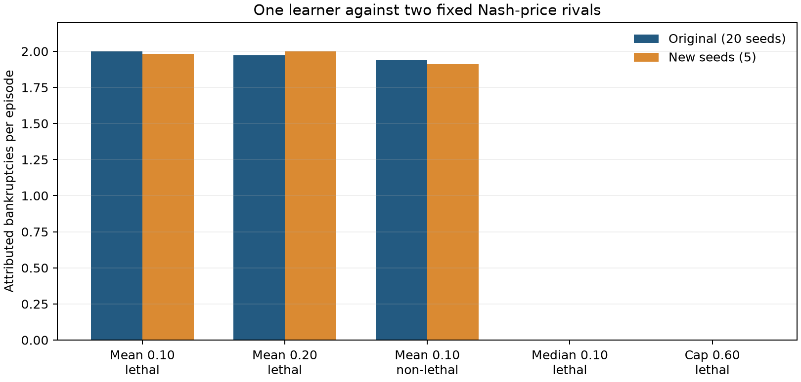
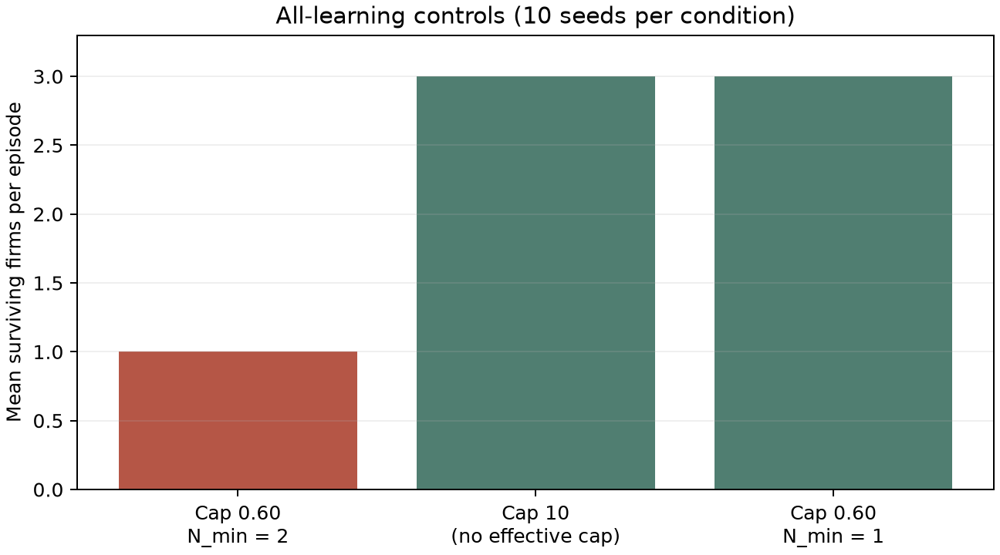
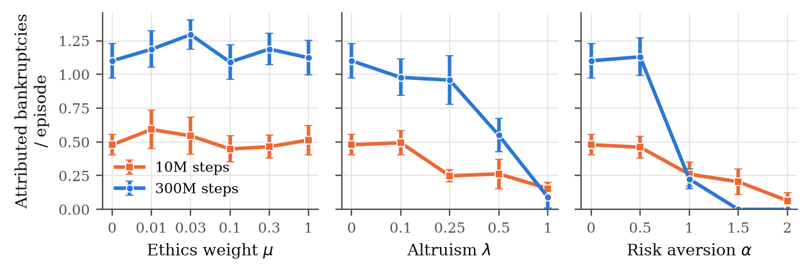

# Weaponizing the Watchdog
## Strategic Pricing and Regulatory Exploitation in a Multi-Agent Market

**Authors:** Krish Goradia, Hem Tilva, Satvik Sharma

**Course:** Multi-Agent Systems

**Project type:** Computational study of strategic interaction and multi-agent learning

## Abstract

Price-monitoring systems may classify a seller as unusually expensive by comparing its price with those of other sellers. This project investigates whether a learning seller can manipulate such a relative benchmark: by lowering its own price, it may cause competing sellers to be flagged and suspended. We model sellers as agents in a repeated differentiated-product market with random audits, fixed operating costs, capital reserves, and bankruptcy. We derive a condition under which a mean-based rule flags high-price rivals and compare it with a median-based rule and an absolute price cap. We then evaluate independent tabular Q-learning in controlled simulated markets.

In a saved 20-seed experiment with one learner and two fixed Nash-price rivals, the mean-rule condition with a short initial capital buffer produced an average of 2.000 rival bankruptcies per episode attributed by the simulator to induced bans; the median and cap conditions produced none. A separate five-seed rerun showed the same broad pattern. However, the larger-buffer mean-rule condition also produced an average of 1.938 attributed rival bankruptcies, contradicting a simple claim that a single ban must be lethal for elimination to occur. When all three sellers learn, framing also emerges, and it grows with training: under the mean rule, attributed bankruptcies rise from 0.51 per episode at 10 million steps to 1.34 at 1 billion, against 0.56 under the median rule. A four-seller market shows the same ranking. Further all-learning controls show substantial bankruptcy under a price cap even when no bans are attributed to peer-price manipulation. Step-level traces show the mechanism: sellers price above the cap, two are banned into bankruptcy, and the last one prices freely once audits stop. With adequate training (300M steps), higher risk aversion and altruism sharply reduce framing, and sellers with risk aversion α ≥ 1.5 never frame at all, while an ethics penalty has no detectable effect. These are simulation findings, not evidence of real-world misconduct or proof of agent intent. The key contribution is a testable mechanism and an evaluation that distinguishes model-defined framing from other market failures.

## 1. Introduction and research question

Automated sellers choose prices in response to competitors, and a marketplace may use a watchdog to identify prices that appear unusually high. If the watchdog's reference is the average of current seller prices, each seller partly controls the benchmark used to judge its competitors. A seller that undercuts can lower the average, potentially making a rival's unchanged price exceed the regulatory threshold.

Our central question is:

> **When can a learning seller exploit a relative-price watchdog to harm competitors, and how do the rule and capital buffer affect the observed outcome?**

We study three related questions. First, which rules admit unilateral manipulation in a simple two-price market? Second, does a Q-learner discover behavior associated with induced bans against fixed-price rivals? Third, do the same conclusions remain straightforward when every seller learns or when behavioral traits change?

The problem connects strategic game modelling with learning from interaction, both directions identified in the course guidelines. It builds on research on algorithmic pricing and Q-learning [1, 2]. Unlike a study of collusion alone, our mechanism concerns an indirect interaction between a seller's price and the rule applied to others. The market is synthetic: model assumptions are chosen to expose the mechanism, not calibrated to an observed platform.

## 2. Market and decision model

### 2.1 Agents, actions, and information

There are N sellers and a rule-based watchdog. In each period, every active seller selects a price from a shared finite grid. An active seller is solvent and not currently suspended. A suspended seller cannot make sales; a bankrupt seller exits for the remainder of the episode. The watchdog samples active sellers for audit and suspends an audited seller when its price violates the selected rule.

The environment tracks prices, capital, and ban timers. A Q-learner receives a compressed observation consisting of the previous price vector, inactivity indicators for all sellers, and a three-level bin for its own capital. An inactivity indicator combines suspension and bankruptcy, and the observation does not contain exact rival capital or ban timers. Consequently, the learner's observation is not generally a complete Markov state. Sellers do not need to know the demand function or other sellers' strategies to update their Q-tables; the simulator knows the rules and market parameters. The watchdog is fixed in the experiments reported here; it is not a learning agent.

### 2.2 Demand, profit, and capital

Let A_t denote the active firms and p_i,t the price selected by seller i. Consumer choice follows a multinomial logit model with an outside option [3]. For an active seller,

\[
s_i(\mathbf p_t)=\frac{\exp((a_i-p_{i,t})/\sigma)}{\exp(a_0/\sigma)+\sum_{j\in A_t}\exp((a_j-p_{j,t})/\sigma)}.
\]

Here a_i is product quality, a_0 is the outside-option utility, and σ controls substitution sensitivity. For market size Q and marginal cost c_i, operating profit is π_i,t = Q(p_i,t − c_i)s_i for an active seller and zero otherwise. Consumer surplus is computed using the corresponding log-sum expression.

Each solvent firm pays fixed operating cost Φ, including while suspended. Its capital changes as

\[
K_{i,t+1}=\min\{K_{\max},\max(0,K_{i,t}+\pi_{i,t}-\Phi)\}.
\]

Zero capital is absorbing within an episode. The experiments summarized below cap reserves at K_max = K_0, with any surplus above the cap treated as paid out; this assumption makes firms more exposed than under unlimited accumulation. Episodes normally last 500 periods, with a reset to initial capital and active status. An episode ends early if no firm remains solvent; a sole surviving firm continues until the horizon. This episodic implementation is not an infinite-horizon market.

### 2.3 Watchdog rules

The watchdog audits up to B active firms uniformly at random. Flags lead to suspension only for audited firms. The watchdog operates when the active count reaches the configured minimum N_min. We compare:

| Rule | Condition that flags active seller i |
| --- | --- |
| Mean ratio | p_i > (1 + δ) mean(p_j : j ∈ A_t) |
| Median ratio | p_i > (1 + δ) median(p_j : j ∈ A_t) |
| Price cap | p_i > p_cap |

Thresholds are strict. N_min is an important modelling choice: after enough sellers leave or are suspended, regulation can stop. It is therefore part of the experiment rather than an incidental implementation detail.

### 2.4 Why can the mean be manipulated?

Suppose k of N active sellers choose L and the other N − k choose H > L ≥ 0. Under the mean rule, a high-price seller is flagged exactly when

\[
H[k-\delta(N-k)]>(1+\delta)kL.
\]

For H > 0 and nonnegative δ, this requires k > δ(N − k). If L > 0, the equivalent price-ratio condition is

\[
\frac{H}{L}>\frac{(1+\delta)k}{k-\delta(N-k)}.
\]

The inequality before division also covers L = 0, a price included in our grid. For example, with three active sellers, prices (0, 0.30, 0.30), and δ = 0.10, the mean is 0.20 and both high-price sellers exceed 0.22. Being flagged does not guarantee suspension: the seller must also be selected for audit.

For the same two-price construction, if fewer than half of the sellers choose L, the median remains H and the high-price sellers cannot be flagged for δ ≥ 0. This protection disappears when the number of active sellers is even and k = N/2. The implementation takes the median of an even count as the average of the two middle prices, so with exactly two active sellers the median equals the mean, and the median rule flags exactly the same prices as the mean rule. Because N_min = 2 in our experiments, regulation continues after the first exit, and from that point the median rule can be manipulated in the same way as the mean rule. A cap depends only on the seller's own price, so another seller's price cannot directly change that seller's flag. These are statements about flagging under the specified rules, not guarantees of welfare or immunity from all strategic behavior. The median result also depends on the two-price construction; real price distributions may be more complicated.

## 3. Algorithms and evaluation

### 3.1 Learning and benchmarks

Each learning seller maintains a table of action values and chooses prices using ε-greedy exploration. The ordinary one-step Q-learning update is

\[
Q_i(o,a)\leftarrow Q_i(o,a)+\eta\left[r_i+\gamma\max_{a'}Q_i(o',a')-Q_i(o,a)\right].
\]

The implementation also accumulates discounted rewards across a suspension before closing the pending transition. Q-values are updated during training; evaluation freezes the learned tables and uses greedy actions. Learning rate η = 0.10, discount factor γ = 0.95, and exploration decays from 1.0 to 0.01 over 60% of the training run. These independently learning agents face changing opponents, so the standard single-agent convergence guarantee [2] does not apply here [4].

The main controlled comparison uses one learner and two sellers fixed at their initial-market discrete Bertrand–Nash prices. The benchmark is computed on the same price grid. Other experiments let every seller learn. The repository also implements reduced-state exact dynamic programming, but we do not claim a measured DP–learning gap here: a fully matched comparison with traceable outputs is not established by the files used for this report.

The baseline learning reward uses normalized operating profit, not profit after fixed costs; overhead affects capital and survival. In trait experiments the reward additionally uses an anchored CRRA utility, a weighted external-surplus term, and a penalty for model-defined counterfactual harm. The implemented utility shift is ε = 0.01. All firms in a trait condition receive the same selected trait value; these sweeps do not represent a mixed population.

### 3.2 Outcome measures and attribution

- **Fresh bans per episode** counts new suspensions.
- **Unilateral weaponization rate W** is the fraction of fresh bans for which replacing one rival's current price with its fixed Nash benchmark removes the flag. The recorded code returns zero when there are no bans; in that case the ratio has no events and is not evidence of measured zero risk.
- **Attributed bankruptcies per episode** counts bankruptcies while serving a ban whose flag was attributed to a unilateral or joint Nash-price counterfactual. For a joint counterfactual, the implementation assigns one active rival as the bookkeeping inducer. This is a model-defined proxy, not a full trajectory-level causal estimate; in particular it does not prove intent or that bankruptcy would have been avoided in a replay without that action.
- **Other bankruptcies** are total bankruptcies minus those counted by that proxy. The label does not identify their actual cause.
- **Survivors** are initial firms minus bankruptcies per episode. The reported learner profit is average operating profit per evaluation period, not a discounted lifetime return or net profit after fixed costs.

Seed-level runs are the units summarized below. Episodes within one frozen-policy run share a trained policy and are not independent training replications. W is reported as a mean of per-seed rates, not as a pooled ratio over all bans.

### 3.3 Validating the measures on a scripted attacker

Before applying W and the bankruptcy attribution to learners, we checked them against a scripted attacker whose behavior is known. The attacker prices at zero whenever at least N_min firms are active and at the monopoly price otherwise. Its rivals price at Nash. The test suite ([test_scripted_attacker.py](tests/test_scripted_attacker.py), [test_framing_mechanics.py](tests/test_framing_mechanics.py)) checks that:

- under the mean rule, the attacker causes bans, and W is at least 0.80;
- under the median rule (N = 3 and N = 4) and under a price cap, the same attacker causes no bans, and W is 0;
- every attributed bankruptcy is credited to the attacker and none to the honest rivals;
- with a lethal buffer, every attributed ban ends in bankruptcy, while with a non-lethal buffer fewer than a quarter do;
- a market of honest Nash-pricing firms produces no bans and no bankruptcies.

All of these tests pass. The measures therefore detect framing when it is present by construction and report none when it is absent.

## 4. Experimental design

The main study uses N = 3, 11 prices uniformly spaced from 0 to 1.5, Q = 1, quality a_i = 2, a_0 = 0, marginal costs 0, σ = 0.25, Φ = 0.05, audit budget B = 1, and N_min = 2. The discrete Nash benchmark in this setting is p = 0.30 with operating profit approximately 0.100 per firm and period. The benchmark profit exceeds fixed cost, although other prices or suspensions can still drain capital.

The saved single-learner experiment uses 20 seeds per condition, 2 million training steps and 50,000 frozen-policy evaluation steps per seed, with 100 evaluation episodes. The lethal configuration has K_0 = 0.15 and T_ban = 4; the initially non-lethal configuration has K_0 = 0.50 with the same ban duration. A single full suspension drains 0.20, excluding any other intervening cash flows. “Non-lethal” therefore refers only to one ban starting from the full initial buffer, not an entire episode with repeated bans.

We additionally reran the same five conditions with five new seeds, 9020–9024. This rerun was chosen after inspection of the existing results and is an **exploratory replication**, not a preregistered confirmatory test. The all-learning controls and robustness study use ten seeds per condition and 10 million training steps; the trait sweep was run at both 10 million and 300 million steps. The four-seller study uses 300 million steps, and a training-length check (Section 5.5) repeats the main all-learning comparison at up to 1 billion steps. Since many configurations were explored and no preregistered comparison or multiplicity correction is documented, the findings below are descriptive; we do not use significance thresholds to claim confirmation.

## 5. Results

### 5.1 A learner against fixed-price rivals

| Rule and initial buffer | Mean W | Fresh bans / episode | Attributed rival bankruptcies / episode | Survivors | Learner profit / period |
| --- | ---: | ---: | ---: | ---: | ---: |
| Mean, δ = 0.10, lethal | 1.000 (0.000) | 2.000 (0.000) | 2.000 (0.000) | 1.000 (0.000) | 1.312 (0.000) |
| Mean, δ = 0.20, lethal | 0.994 (0.006) | 1.985 (0.009) | 1.974 (0.016) | 1.007 (0.004) | 1.283 (0.016) |
| Mean, δ = 0.10, initially non-lethal | 0.971 (0.021) | 16.070 (3.652) | 1.938 (0.042) | 1.062 (0.042) | 1.163 (0.038) |
| Median, δ = 0.10, lethal | — | 0.000 (0.000) | 0.000 (0.000) | 3.000 (0.000) | 0.100 (0.000) |
| Cap = 0.60, lethal | — | 0.000 (0.000) | 0.000 (0.000) | 3.000 (0.000) | 0.100 (0.000) |

*Table 1. Means across 20 seeds from [study_single.csv](results/Krishs-MacBook-Air/all/study_single.csv), with standard errors across seeds (sample standard deviation divided by √n) in parentheses. A standard error of 0.000 means every seed produced the same value to three decimals. A dash indicates no bans, for which W's denominator is zero. The simulator stores W = 0 in these cases. Counts are per episode; profit averages over evaluation periods.*

The mean-rule outcomes are consistent with the model's framing mechanism against these fixed rivals. In the δ = 0.10 lethal condition, the learner's mean operating profit of 1.312 is higher than the initial three-firm Nash operating-profit benchmark of 0.100; these quantities describe different market structures and are not a matched counterfactual estimate of net profit. It is close to the monopoly operating profit available on the grid (about 1.32 at the highest grid price, 1.50). The unconstrained logit monopoly price in this model is about 1.58, so the grid's upper bound slightly limits the sole survivor's profit. The non-lethal condition still shows repeated bans and substantial attributed bankruptcy. Its initial reserve is enough to survive one full ban, but the data do not establish the complete causal history of each bankruptcy. It would be incorrect to conclude that framing requires T_ban Φ ≥ K_0.



*Figure 1. Means for the original 20 seeds and five additional seeds per condition. The new-seed means for attributed bankruptcies are 1.983, 2.000, 1.912, 0.000, and 0.000 in the order shown. The repeated pattern is useful evidence of reproducibility under this configuration, not a guarantee across markets.*

### 5.2 All-learning controls

| Condition | Attributed bankruptcies / episode | Other bankruptcies / episode | Survivors |
| --- | ---: | ---: | ---: |
| Cap = 0.60, N_min = 2 | 0.000 (0.000) | 1.997 (0.003) | 1.003 (0.003) |
| Cap = 10, effectively inactive for this grid | 0.000 (0.000) | 0.000 (0.000) | 3.000 (0.000) |
| Cap = 0.60, N_min = 1 | 0.000 (0.000) | 0.000 (0.000) | 3.000 (0.000) |

*Table 2. Means (standard errors) across ten seeds per condition from [cap/no-effective-cap](results/athena/controls/control_cap_noreg.csv) and [N_min = 1](results/athena/controls/control_cap_nmin1.csv) controls. All three sellers learn. These controls were first run with an ad-hoc driver that was not kept. We rewrote it as [run_cap_controls.py](experiments/run_cap_controls.py) and reran all three conditions with the same seeds on a different machine ([cap_controls.csv](results/controls_rerun/cap_controls.csv)); every number matches exactly.*



*Figure 2. Mean survivors in the three saved control conditions.*

Under the cap with N_min = 2, almost two firms per episode go bankrupt without an attributed framing event. Thus market concentration or bankruptcy alone cannot establish watchdog manipulation. In that condition, fresh bans (1.997 per episode) equal bankruptcies (1.997). Under a cap, a seller can be flagged only if its own price exceeds 0.60, so every one of these bans followed a seller's own above-cap price. With K_0 = 0.15, one ban is lethal.

To see the sequence directly, we retrained the same ten control seeds and recorded step-by-step traces of two frozen-policy episodes per seed ([trace_cap_control.py](experiments/trace_cap_control.py); outputs in [results/cap_trace](results/cap_trace/)). In all 20 traced episodes with N_min = 2, the same sequence occurs:

1. While at least two firms are active, two firms set prices above the cap (anywhere from 0.75 to 1.50) during the first few periods.
2. Each is audited, suspended, and bankrupt by period 16 at the latest.
3. The remaining firm is then alone, below N_min, so audits stop. It charges the top grid price of 1.50 for the remaining ~485 periods of the episode.

Which firm survives differs across seeds and episodes, so this is not a fixed role assignment. The pattern is a gamble: pricing above the cap risks a lethal audit, but the firm that avoids an audit inherits an unregulated monopoly. With N_min = 1, the traces show no above-cap prices in any of the 20 episodes. Prices sit at or just below the cap (about 0.60), and no firm is banned or bankrupt. Without an effective cap the saved mean price is 0.63, also with no bans. The traces were produced on a different machine from the saved controls, but they reproduce the saved outcome of two bankruptcies per episode. The control therefore shows that the point at which regulation switches off creates an incentive of its own, separate from peer-price framing.

**Welfare.** The collusion index Δ = (π̄ − π^N)/(π^M − π^N) and social welfare loss SWL (total surplus relative to Nash) are recorded in every CSV. When the single learner frames its rivals under the mean rule (δ = 0.10, lethal), Δ = 0.89 and SWL = 0.18: average profit is close to joint monopoly and total surplus is 18% below honest competition. Under the median rule and the cap both are zero. With all sellers learning for 1B steps, SWL is 0.183 (0.000) under the mean rule and 0.127 (0.019) under the median. The cap with N_min = 2 costs as much as framing (SWL 0.182), while the same cap with N_min = 1 costs almost nothing (0.001). Most of the welfare loss therefore comes from the market collapsing to one firm, whichever mechanism causes it.

In the all-learning robustness study, mean-rule attributed bankruptcies were higher than median-rule values for each recorded parameter setting, but substantial other bankruptcies appeared under both rules; for example, at δ = 0.10 the respective means (standard errors) were 0.513 (0.121) and 0.253 (0.070) attributed bankruptcies and 1.490 (0.120) and 1.748 (0.070) other bankruptcies per episode. With ten seeds, that particular difference is about two standard errors at this training length. Section 5.5 shows that it widens considerably with longer training. The non-zero median values are consistent with Section 2.4: once one firm exits, the two remaining active firms face a median equal to their mean, so framing becomes possible under the median rule as well. These comparisons are exploratory and do not establish a universal ranking.

### 5.3 Behavioral traits

We varied one trait at a time, giving all three learners the same value, under the mean rule with δ = 0.10. Each configuration was trained for 10M steps ([study_h3.csv](results/Krishs-MacBook-Air/all/study_h3.csv)) and again for 300M steps ([study_h3_300M.csv](results/traits_300M/study_h3_300M.csv)), because Section 5.5 shows 10M steps is not enough for framing levels to settle. The 300M results are the ones to rely on, and they differ from the 10M results in important ways.

| Trait value | Attributed bankruptcies / episode, 10M | Attributed bankruptcies / episode, 300M | Survivors, 300M |
| --- | ---: | ---: | ---: |
| Baseline (all traits 0) | 0.479 (0.077) | 1.101 (0.127) | 0.95 (0.06) |
| Ethics μ = 0.1 | 0.448 (0.098) | 1.091 (0.126) | 0.98 (0.01) |
| Ethics μ = 1 | 0.514 (0.110) | 1.123 (0.129) | 1.09 (0.09) |
| Altruism λ = 0.25 | 0.249 (0.046) | 0.958 (0.180) | 1.33 (0.23) |
| Altruism λ = 0.5 | 0.263 (0.110) | 0.549 (0.123) | 1.85 (0.20) |
| Altruism λ = 1 | 0.155 (0.047) | 0.090 (0.078) | 2.72 (0.16) |
| Risk aversion α = 0.5 | 0.461 (0.083) | 1.130 (0.139) | 1.16 (0.21) |
| Risk aversion α = 1 | 0.261 (0.091) | 0.226 (0.073) | 2.64 (0.11) |
| Risk aversion α = 1.5 / 2 | 0.205 / 0.065 | 0.000 (0.000) | 3.00 (0.00) |

*Table 3. Means (standard errors) across ten seeds per value. All three sellers learn. Every value in each sweep is in the CSVs; the table shows a selection.*

- **Risk aversion** has the strongest effect. At 300M steps, framing falls to zero at α ≥ 1.5: no seller is ever banned and all three survive in every seed. The Spearman correlation between α and attributed bankruptcies is −0.84. Framing is a gamble on a lethal audit, and concave utility makes that gamble unattractive.
- **Altruism** also sharply reduces framing at 300M steps, from 1.10 to 0.09 attributed bankruptcies, with survivors rising from 0.95 to 2.72 (Spearman −0.61). At 10M steps this effect was weak and non-monotonic, so the shorter study understated it.
- **The ethics penalty** has no detectable effect at either training length. At 300M steps attributed bankruptcies stay between 1.09 and 1.30 for every μ from 0 to 1 (Spearman 0.02). A likely reason is scale. At μ = 1, the penalty for one framed ban equals about ten periods of Nash profit. Eliminating both rivals raises the learner's per-period profit from 0.10 to about 1.3 over a discounted horizon of 1/(1−γ) = 20 periods, a gain of roughly 24 reward units against a penalty of at most 2.

These are exploratory results from ten seeds per value without a multiplicity correction.



*Figure 3. Attributed bankruptcies per episode as each trait varies, at 10M and 300M training steps. Ten seeds per point; error bars are one standard error. Generated by `scripts/make_paper_figures.py`.*

### 5.4 Four sellers

With N = 3, the market can shrink to two active firms after one exit, and Section 2.4 shows that the median rule then behaves exactly like the mean rule. With N = 4 and N_min = 3, the watchdog only operates while there are three or four active sellers, so the median always compares a seller with at least two others. We ran this setting, and N = 4 with N_min = 2 for comparison, with all four sellers learning, ten seeds per condition, and 300 million training steps each.

| Rule | N_min | Mean W | Attributed bankruptcies / episode | Other bankruptcies / episode | Survivors |
| --- | ---: | ---: | ---: | ---: | ---: |
| Mean, δ = 0.10 | 3 | 0.157 (0.035) | 0.548 (0.086) | 1.453 (0.086) | 2.00 (0.00) |
| Median, δ = 0.10 | 3 | 0.071 (0.015) | 0.183 (0.038) | 1.824 (0.038) | 1.99 (0.00) |
| Mean, δ = 0.10 | 2 | 0.209 (0.034) | 0.922 (0.113) | 2.081 (0.113) | 1.00 (0.00) |
| Median, δ = 0.10 | 2 | 0.139 (0.016) | 0.478 (0.074) | 2.524 (0.074) | 1.00 (0.00) |

*Table 4. Means (standard errors) across ten seeds per condition from [study_n4long.csv](results/Krishs-MacBook-Air/all/study_n4long.csv).*

The mean rule again produces more attributed bankruptcies than the median rule: about three times as many with N_min = 3 (0.548 vs 0.183, a gap of about four standard errors) and about twice as many with N_min = 2. The median rule's attributed bankruptcies are lower with N_min = 3, consistent with its protection being stronger when it always compares at least three sellers. They are not zero. In an all-learning market prices are spread across several values rather than two, and a seller close to the median can move it. In every condition, the market still ends with exactly N_min − 1 survivors, the point at which audits stop. Most bankruptcies are not attributed to framing, so the "race to be the unregulated survivor" seen in the cap control (Section 5.2) appears to operate here as well.

### 5.5 Is the all-learning market trained long enough?

With N = 3 and 11 prices, each learner's observation space has 11³ × 2³ × 3 = 31,944 states. One might worry that framing is rare in the all-learning experiments only because the learners have not trained long enough to find it. The trainer records the fraction of states each learner visits at least once during training. In the 10M-step all-learning runs this is about 15%. In the single-learner runs it is only 0.1–0.4%, because fixed rivals keep most price combinations unreachable, yet the single learner finds framing within 2M steps.

To test the all-learning case directly, we retrained the δ = 0.10 mean and median conditions from the robustness study with the same ten seeds at 100M, 300M, and 1B training steps ([check_training_length.py](experiments/check_training_length.py); outputs in [results/training_length](results/training_length/)).

| Training steps | State coverage | Mean rule: W | Mean rule: attributed bankruptcies | Median rule: W | Median rule: attributed bankruptcies | Median rule: survivors |
| ---: | ---: | ---: | ---: | ---: | ---: | ---: |
| 10M | 0.15 | 0.231 (0.061) | 0.513 (0.121) | 0.129 (0.037) | 0.253 (0.070) | 1.00 (0.00) |
| 100M | 0.22 | 0.450 (0.041) | 0.998 (0.071) | 0.230 (0.042) | 0.428 (0.081) | 1.37 (0.27) |
| 300M | 0.23 | 0.625 (0.064) | 1.268 (0.100) | 0.505 (0.040) | 0.753 (0.105) | 1.28 (0.16) |
| 1B | 0.23 | 0.720 (0.068) | 1.339 (0.119) | 0.438 (0.091) | 0.559 (0.116) | 1.53 (0.21) |

*Table 5. Means (standard errors) across ten seeds; δ = 0.10, N = 3, N_min = 2, all sellers learning. The 10M row is from the robustness study.*

Training length matters. Under the mean rule, attributed bankruptcies more than double between 10M and 300M steps and then level off: the change from 300M to 1B is smaller than one standard error. Under the median rule, the values rise and then fluctuate between about 0.4 and 0.75, and more firms survive with longer training. The visited state set stops growing after about 100M steps, so the later changes come from learners refining their values in states they already visit, not from discovering new ones. The difference between the rules becomes clearer with training: at 1B steps the mean rule produces 1.34 attributed bankruptcies against 0.56 for the median, a gap of about 4.7 standard errors, compared with about two standard errors at 10M.

This has a direct consequence for the other all-learning results. The robustness study and the cap controls were trained for 10M steps, so their framing levels should be read as underestimates of what longer-trained learners would do. The trait sweeps were rerun at 300M steps (Section 5.3). The direction of the mean–median comparison is the same at every training length we tested. Rerunning the trait sweeps at 300M steps changed their conclusions (Section 5.3).

### 5.6 Defences against learners

We tested two defences, both implemented in the native engine ([run_defences.py](experiments/run_defences.py), [patient_attacker.py](experiments/patient_attacker.py); outputs in [results/defences](results/defences/)):

- **EMA reference.** Prices are judged against r_t = β·r_{t−1} + (1−β)·mean(p_t), so a one-period undercut moves the reference only a fraction 1−β as far.
- **Escrow.** A flagged, audited seller is not suspended. Its profit above the Nash level for that period is removed instead.

**What the algebra says.** If one seller holds L while the others stay at H, the EMA reference converges to the mean m = (L + (N−1)H)/N, so a rival is flagged after t* = ⌈ln((H/(1+δ) − m)/(H − m)) / ln β⌉ periods whenever the mean rule would flag it. With L = 0.15, H = 0.30, δ = 0.10, t* is 4, 16, and 79 periods for β = 0.80, 0.95, 0.99. At 0.15 the attacker still earns 0.07 per period, more than the fixed cost, so it can afford to wait. Under escrow, an honest seller at its Nash price that is undercut earns less than its Nash profit, so its penalty is zero: framing cannot hurt it.

| Rule | Patient attacker: rival exits / episode | Single learner, 2M steps | Single learner, 300M steps | All learners, 300M: bankruptcies / episode | All learners: survivors | All learners: mean price |
| --- | ---: | ---: | ---: | ---: | ---: | ---: |
| Mean | 2.00 (0.00) | 2.00 (0.00) | 2.00 (0.00) | 2.08 (0.02) | 0.92 (0.02) | 1.44 |
| Median | — | — | — | 1.72 (0.16) | 1.28 (0.16) | 1.04 |
| EMA β = 0.80 | 2.00 (0.00) | 0.00 (0.00) | 2.00 (0.00) | 0.72 (0.29) | 2.28 (0.29) | 0.50 |
| EMA β = 0.95 | 2.00 (0.00) | 0.00 (0.00) | 0.00 (0.00) | 1.00 (0.33) | 2.00 (0.33) | 0.63 |
| EMA β = 0.99 | 2.00 (0.00) | 0.00 (0.00) | 0.00 (0.00) | — | — | — |
| Mean + escrow | 0.00 (0.00) | 0.00 (0.00) | 0.00 (0.00) | 0.00 (0.00) | 3.00 (0.00) | 0.69 |

*Table 6. Patient attacker: a scripted seller that holds 0.15 while audits run, against Nash rivals (5 seeds). Single learner: one Q-learner against two fixed Nash rivals (20 seeds); the column counts rivals bankrupted per episode. All learners: three Q-learners (10 seeds). Mean (standard error); δ = 0.10, lethal bans; Nash price 0.30.*

- **EMA delays framing but does not prevent it.** The patient attacker bankrupts both rivals in every episode for every β. A single learner finds nothing after 2M steps, but after 300M steps it frames both rivals in all 20 seeds at β = 0.80 (a 4-period attack). At β ≥ 0.95 (16+ periods) no learner found it. With all sellers learning, EMA cuts bankruptcies from 2.08 to 0.72–1.00 per episode, but the outcome splits by seed: at β = 0.95, five seeds end with one firm and five with all three.
- **Escrow removes framing.** No seller is suspended (by construction), no sanction is attributed to a rival, and all three firms survive in every seed. The cost is weak price discipline: with all sellers learning, prices settle at 0.54–0.85 (mean 0.69), well above Nash (0.30) and close to the unregulated control (0.63). Total surplus barely changes (SWL 0.005) because, with almost no outside option, higher prices mostly move surplus from consumers to sellers.
- **Measurement caveat.** Under EMA the one-period Nash counterfactual undercounts framing, because the reference was moved in earlier periods. The patient attacker causes 2.00 bans per episode, of which only 1.2–1.4 are attributed. This table therefore counts bankruptcies directly.

## 6. Discussion and limitations

The algebra and controlled single-learner simulation make a narrow but meaningful case: an endogenous mean benchmark can allow one seller's price to change whether fixed-price rivals are flagged. The median and cap baselines remove that particular unilateral channel in the two-price example with three active sellers. The median protection fails once only two sellers remain active, so the rule's design interacts with N_min. The all-learning controls show why that result must not be generalized to every bankruptcy, rule, or market setting. A rule can affect behavior and survival even when the counterfactual attribution metric reports no framing.

The main limitations are:

1. **Synthetic market and finite horizon.** Demand, identical products, price grid, overhead, reserve cap, and episode resets are modelling choices. Actual platforms may differ in enforcement, financing, demand, and seller behavior.
2. **Partial observation and learning dynamics.** Independent Q-learners see compressed observations and face changing opponents. A frozen greedy policy after a fixed training budget is not proof of equilibrium or optimality. Section 5.5 shows that framing levels in the all-learning market are still changing at 10M steps and settle only after a few hundred million steps. The robustness and control results were measured at 10M steps.
3. **Attribution.** Nash-price flag counterfactuals are useful diagnostics, but the bankruptcy proxy does not replay the market without the intervention. Joint attribution to one seller is a bookkeeping convention, and W is undefined if no bans occur.
4. **Comparability.** The single-learner comparison uses fixed Nash-price rivals, whereas the controls and trait study have all sellers learning. Results from these settings should not be treated as estimates of the same causal effect.
5. **Statistical and provenance limits.** The study includes multiple exploratory sweeps. Figures from before the learning-dynamics fix (extensions, DQN, old phase diagrams) are kept in `plots/legacy/` and are not used as evidence. Tables report standard errors across seeds, but with 5–20 seeds per condition and no multiplicity correction, small differences should not be over-read. A small five-seed replication does not replace a preregistered study or broader sensitivity analysis.

Useful next steps are combining escrow with a price cap or a stronger fine (so the rule resists framing and still disciplines high prices), attributing harm over multi-period windows, rerunning the robustness grid and controls at 300M+ training steps, matched trajectory-level counterfactual replays, robustness to uncapped capital and alternative horizons, and a prospective experiment plan specifying primary outcomes, seed counts, and comparisons. A matched exact-DP versus learning study would help distinguish feasibility from learnability. The existing EMA, escrow, demand-shock, and DQN extensions are possible follow-on work; their historical figures are not used as evidence in this report.

## 7. Conclusion

This project formulated and implemented a multi-agent pricing market with a regulatory watchdog. A simple derivation identifies when undercutting can make high-price sellers violate a mean-based rule. Simulations show the mechanism under a specific one-learner, fixed-rival configuration, including when one ban alone is insufficient to exhaust the initial buffer. When all sellers learn, framing emerges more strongly with longer training, and the mean rule permits clearly more of it than the median rule with three and with four sellers. The harm measures were first validated on a scripted attacker. Other controls show that bankruptcies can arise without the simulator attributing them to framing. When regulation switches off below N_min, sellers have a reason to accept lethal bans in order to become the sole unregulated survivor. With 300M training steps, framing falls to zero as risk aversion rises and falls sharply with altruism, while the ethics penalty has no detectable effect. The study illustrates both a potential weakness of peer-dependent regulation and the importance of separating a precise mechanism from broader claims about welfare, intent, or real markets.

## References

1. Calvano, E., Calzolari, G., Denicolò, V., & Pastorello, S. (2020). Artificial intelligence, algorithmic pricing, and collusion. *American Economic Review, 110*(10), 3267–3297. https://doi.org/10.1257/aer.20190623
2. Watkins, C. J. C. H., & Dayan, P. (1992). Q-learning. *Machine Learning, 8*, 279–292. https://doi.org/10.1007/BF00992698
3. McFadden, D. (1974). Conditional logit analysis of qualitative choice behavior. In *Frontiers in Econometrics*. Academic Press. https://eml.berkeley.edu/reprints/mcfadden/zarembka.pdf
4. Buşoniu, L., Babuška, R., & De Schutter, B. (2008). A comprehensive survey of multiagent reinforcement learning. *IEEE Transactions on Systems, Man, and Cybernetics, Part C, 38*(2), 156–172. https://doi.org/10.1109/TSMCC.2007.913919

## Appendix: Reproducing the reported results

From the repository root, install the dependencies in `requirements.txt` and build the native engine with `python scripts/build_engine.py`. Then run:

```text
python scripts/audit_saved_results.py
python scripts/plot_report_results.py
python experiments/replicate_report.py
python experiments/trace_cap_control.py --n-min 2
python experiments/trace_cap_control.py --n-min 1
python experiments/check_training_length.py --steps 100000000
python experiments/check_training_length.py --steps 300000000
python experiments/check_training_length.py --steps 1000000000
python experiments/run_cap_controls.py
python scripts/benchmark_backends.py
python experiments/run_defences.py single
python experiments/run_defences.py single --steps 300000000
python experiments/run_defences.py all
python experiments/patient_attacker.py
python -m pytest -q --ignore=tests/test_dqn_agent.py
```

The audit prints summaries of the saved original and control CSVs; the plot script reads those CSVs and the separately saved new-seed run. The replication script reruns 25 native-engine jobs and overwrites only `results/report_replication/single_learner.csv`; preserve that file first if comparing runs. Native binaries, toolchains, platforms, and random-number implementations may affect exact reproduction. The full test suite additionally requires PyTorch, which was not installed in the replication environment. On that machine (Windows x86-64; see the replication metadata), the other 95 tests passed, and a single historical seed reproduced its recorded outcome. That is not a verification of every historical run. The original 20-seed study ran on an Apple M5 machine (macOS arm64, Python 3.11.15) at commit 2457a32, and the controls ran on a Windows x86-64 machine at commit 908e83b, as recorded in each results folder's `machine.txt`. The five-seed replication matches the original study closely across these platforms (Figure 1). Replication environment details are recorded in [replication metadata](results/report_replication/metadata.txt).
