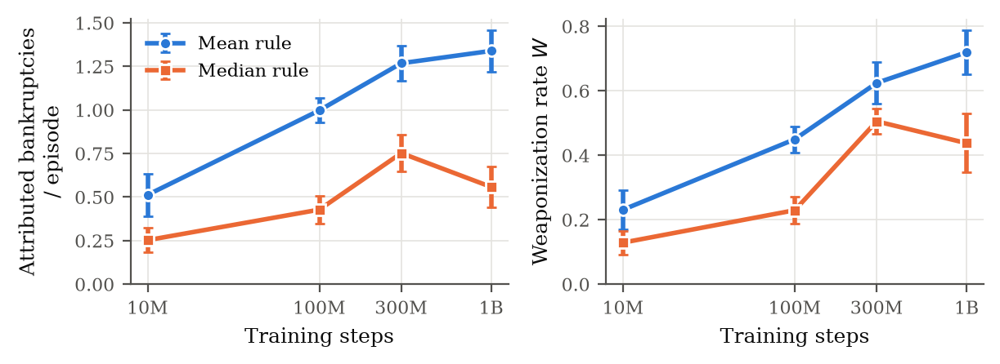
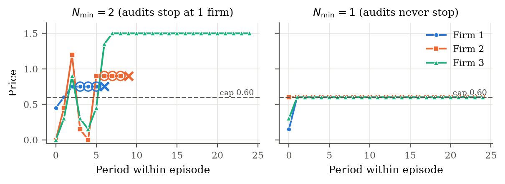

# Weaponizing the Watchdog: Regulator-Exploiting Strategies in Multi-Agent Learning Markets

## Overview

Automated regulatory mechanisms ("watchdogs") are commonly deployed in online platforms to detect price gouging and abnormal price spikes by comparing seller prices against a market reference price. When sellers are adaptive learning agents (such as reinforcement learning algorithms), relative pricing rules create an unintended attack surface:

1. **Strategic Undercutting:** An attacking agent drastically lowers its price toward marginal cost.
2. **Reference Price Deflation:** Relative market metrics (such as the market mean) fall sharply.
3. **Regulatory Flagging:** An innocent competitor pricing at standard competitive levels exceeds the relative threshold and is flagged.
4. **Audit and Suspension:** The flagged firm is audited, penalized, and suspended from the market for a ban duration $T_{\text{ban}}$.
5. **Capital Drain & Bankruptcy:** While suspended, the firm earns zero revenue ($\pi = 0$) but continues to pay recurring fixed costs ($\Phi$). If capital depletes to zero ($K \le 0$), the firm enters permanent, absorbing bankruptcy.
6. **Monopoly Extraction:** With the competitor permanently removed, the attacker raises prices to monopoly levels to capture long-run supra-competitive rents.

This project investigates under what market conditions, regulatory architectures, and agent traits this predatory framing behavior emerges, using decentralized tabular Q-learning.

**Paper:** [`paper/main.tex`](paper/main.tex) (arXiv template). **Detailed write-up:** [`FINAL_REPORT.md`](FINAL_REPORT.md).

---

## Results at a glance

All figures below are generated by `python scripts/make_paper_figures.py` from the CSVs committed under `results/`. Error bars are one standard error across seeds.

### 1. A single learner frames fixed rivals under the mean rule, never under median or cap


One Q-learner against two Nash-pricing rivals (20 seeds, plus 5 new seeds on a different machine). Under the mean rule it eliminates both rivals in every episode (2.00 attributed bankruptcies per episode). Under the median rule and the price cap, all three firms survive. It also eliminates rivals when one ban is not lethal (1.94), by framing them repeatedly.

### 2. When all sellers learn, framing grows with training



Same ten seeds retrained for 10M to 1B steps. Under the mean rule, attributed bankruptcies rise from 0.51 to 1.34 per episode and level off after 300M. The median rule stays clearly lower (0.56 at 1B), and the gap grows from about 2 to about 4.7 standard errors.

### 3. A price cap cannot be gamed by rivals, but switching audits off can



Step-level trace under a 0.60 price cap. With `N_min = 2` (audits stop once one firm is left), two firms price above the cap, get banned into bankruptcy, and the survivor charges 1.50 unaudited. This happens in all 20 traced episodes. With `N_min = 1`, every firm stays at the cap and nobody dies.

### 4. Behavioural traits


Each trait varied for all three learners, at 10M and 300M training steps (10 seeds per point). At 300M steps, risk aversion removes framing completely (zero attributed bankruptcies at α ≥ 1.5, all firms survive), and altruism cuts it from 1.10 to 0.09 per episode. An ethics penalty up to μ = 1 has no detectable effect. Short training (10M) understated the altruism effect.

### 5. Four sellers

With N = 4 and `N_min = 3` (300M steps, 10 seeds), the mean rule causes 0.55 attributed bankruptcies per episode against 0.18 for the median (`results/Krishs-MacBook-Air/all/study_n4long.csv`).

---

## Market & Game Theoretical Formulation

The environment is modeled as an infinite-horizon, discrete-time Markov game $\mathcal{M} = \langle \mathcal{N}, \mathcal{S}, \{\mathcal{A}_i\}, \mathcal{P}, \{R_i\}, \gamma \rangle$ parameterized by a differentiated-products logit oligopoly.

### Market Environment
- **Firms:** $\mathcal{N} = \{1, \dots, N\}$ indexed by $i$, acting at discrete time periods $t \in \{0, 1, \dots\}$.
- **Cost Structure:** Constant marginal cost $c_i \ge 0$, per-period fixed operational overhead $\Phi > 0$, and capital reserve $K_{i,t} \ge 0$ initialized to $K_{i,0} = K_0$. Market buyer volume is $Q > 0$.
- **Action Space:** Discrete price grid $\mathcal{A}_i = \{p^{(1)} < \dots < p^{(M)}\}$ with $p^{(1)} \ge c_i$. The joint action vector is $\mathbf{p}_t = (p_{1,t}, \dots, p_{N,t}) \in \prod_i \mathcal{A}_i$.
- **Ban Dynamics & Bankruptcy:**
  - Ban countdown timer $\tau_{i,t} \in \{0, \dots, T_{\text{ban}}\}$, with ban indicator $b_{i,t} = \mathbb{I}(\tau_{i,t} > 0)$.
  - Active seller set: $\mathcal{N}^{\text{act}}_t = \{i \in \mathcal{N} : b_{i,t} = 0 \text{ and } K_{i,t} > 0\}$.
  - Bankruptcy occurs when $K_{i,t} = 0$. Bankruptcy is absorbing: bankrupted firms permanently exit the market.

### Demand and Profit System
Buyers follow a multinomial logit choice model. The market share of active firm $i \in \mathcal{N}^{\text{act}}_t$ is:
$$s_i(\mathbf{p}_t) = \frac{\exp\left(\frac{a_i - p_{i,t}}{\sigma_d}\right)}{\sum_{j \in \mathcal{N}^{\text{act}}_t} \exp\left(\frac{a_j - p_{j,t}}{\sigma_d}\right) + \exp\left(\frac{a_0}{\sigma_d}\right)}$$
where $a_i$ represents product quality, $a_0$ is the outside option utility, and $\sigma_d > 0$ parameterizes consumer price sensitivity. Inactive or banned firms have $s_i(\mathbf{p}_t) = 0$.

Per-period firm operating profit and consumer surplus ($CS$) are given by:
$$\pi_i(\mathbf{p}_t) = Q (p_{i,t} - c_i) s_i(\mathbf{p}_t)$$
$$CS(\mathbf{p}_t) = Q \sigma_d \ln\left(\sum_{j \in \mathcal{N}^{\text{act}}_t} \exp\left(\frac{a_j - p_{j,t}}{\sigma_d}\right) + \exp\left(\frac{a_0}{\sigma_d}\right)\right)$$

### Capital Dynamics
Capital evolves recursively:
$$K_{i,t+1} = \max\{0, \, K_{i,t} + \pi_i(\mathbf{p}_t) - \Phi\}$$
A banned firm cannot generate sales ($\pi_i = 0$) but remains liable for fixed costs $\Phi$. Consequently, a suspension drains $\Phi$ capital per period. If $T_{\text{ban}} \cdot \Phi \ge K_{i,t}$, a single ban cycle can induce permanent exit.

---

## Regulatory Rules & Analytical Exploitability

At the conclusion of period $t$, the regulator selects an audit sample $\text{Aud}_t \subseteq \mathcal{N}^{\text{act}}_t$ of budget size $|\text{Aud}_t| = B$ uniformly at random. Audits happen only while $N_{\text{act},t} \ge N_{\min}$ (default $N_{\min} = 2$; the proposal used 3, but with $N = 3$ that switches the watchdog off after the first exit). Flags $F_{i,t} \in \{0, 1\}$ are evaluated according to one of the following static rules:

1. **Mean-Ratio Rule:**
   $$r_t = \frac{1}{N_{\text{act},t}} \sum_{j \in \mathcal{N}^{\text{act}}_t} p_{j,t}, \qquad F_{i,t} = \mathbb{I}(p_{i,t} > (1 + \delta) r_t)$$
2. **Median-Ratio Rule:**
   $$r_t = \operatorname{median}_{j \in \mathcal{N}^{\text{act}}_t} \{p_{j,t}\}, \qquad F_{i,t} = \mathbb{I}(p_{i,t} > (1 + \delta) r_t)$$
3. **Price Cap Rule (Absolute):**
   $$F_{i,t} = \mathbb{I}(p_{i,t} > p^{\text{cap}})$$
4. **Z-Score Rule (Normalized Reference):**
   $$Z_{i,t} = \frac{p_{i,t} - \bar{p}_t}{\operatorname{std}(\mathbf{p}_t)}, \qquad F_{i,t} = \mathbb{I}(Z_{i,t} > \tau)$$

If firm $i \in \text{Aud}_t$ and $F_{i,t} = 1$, the ban timer updates to $\tau_{i,t+1} = T_{\text{ban}}$; otherwise, $\tau_{i,t+1} = \max\{\tau_{i,t} - 1, 0\}$.

### Mathematical Analysis of Vulnerability (Proposition 1)
Suppose $k$ active firms post price $L$, while the remaining $N - k$ active firms post price $H > L$:

* **Mean-Ratio Rule:** High-priced firms are flagged if and only if $k > \delta(N - k)$ and:
  $$\frac{H}{L} > \frac{(1+\delta)k}{k - \delta(N - k)}$$
  For a single undercutter ($k = 1$), this reduces to $\delta < \frac{1}{N-1}$ and $\frac{H}{L} > \frac{1+\delta}{1 - \delta(N-1)}$. A solitary actor can manipulate the mean benchmark whenever the threshold $\delta$ is sufficiently tight.
* **Median-Ratio Rule:** If $k < N/2$, the median price remains $H$. Thus, no high-priced firm can be flagged by unilateral undercutting; weaponization requires a collusive bloc of at least $\lceil N/2 \rceil$ agents. **Caveat:** the median of an even count is the average of the two middle prices, so with exactly two active firms the median equals the mean and the median rule is as exploitable as the mean rule. With $N = 3$ and $N_{\min} = 2$ this applies after the first exit.
* **Price Cap:** Absolute caps do not depend on peer prices and cannot be manipulated via undercutting.
* **Z-Score Rule:** The standardized score for high-priced firms evaluates to $Z = \sqrt{k / (N - k)}$, independent of $L$. Crashing prices toward marginal cost yields no leverage over the metric beyond an infinitesimal undercut.

---

## Agent Traits and Counterfactual Harm

Each agent is characterized by an intrinsic, private trait vector $\boldsymbol{\theta}_i = (\lambda_i, \mu_i, \alpha_i)$:
- $\lambda_i \in [0, 1]$: **Altruism weight** placed on external social surplus.
- $\mu_i \ge 0$: **Ethics weight**, scaling the direct penalty for inducing rival suspensions.
- $\alpha_i \in [0, 2]$: **Risk aversion** parameter under Constant Relative Risk Aversion (CRRA).

### Trait-Adjusted Reward Formulation
Per-period agent reward is normalized by market volume $Q$:
$$R_i = U_{\alpha_i}\left(\frac{\pi_i(\mathbf{p}_t)}{Q} + \varepsilon\right) - U_{\alpha_i}(\varepsilon) + \lambda_i W_{\text{ext},i}(\mathbf{p}_t) - \mu_i C_{\text{harm}}(i, t)$$

The $-U_{\alpha_i}(\varepsilon)$ anchor makes a zero-profit period (banned or bankrupt) worth exactly zero, so leaving the market is never more attractive than operating. $\varepsilon = 0.01$.

Where:
- Utility function:
  $$U_\alpha(x) = \begin{cases} \frac{x^{1-\alpha}-1}{1-\alpha} & \alpha \ne 1 \\ \ln x & \alpha = 1 \end{cases}$$
  with parameter $\varepsilon > 0$ ensuring bounded values during zero-profit ban periods.
- External surplus:
  $$W_{\text{ext},i}(\mathbf{p}_t) = \frac{CS(\mathbf{p}_t) + \sum_{j \ne i} \pi_j(\mathbf{p}_t)}{N \cdot Q}$$

### Counterfactual Harm Attribution
To isolate true framing from incidental bans, an agent is penalized only when its deviation from the Bertrand-Nash equilibrium price $p_i^N$ was the causal trigger for rival $j$'s penalty:
$$C_{\text{harm}}(i, t) = \sum_{j \ne i} \mathbb{I}\left(j \in \text{Aud}_t, \; F_j(\mathbf{p}_t) = 1, \; F_j(\mathbf{p}_t^{(i \to N)}) = 0\right)$$
where $\mathbf{p}_t^{(i \to N)} = (p_{1,t}, \dots, p_{i-1,t}, p_i^N, p_{i+1,t}, \dots, p_{N,t})$.

---

## Theoretical Benchmarks and Metrics

### Equilibrium Benchmarks
- **Bertrand-Nash Equilibrium ($p^N$):** Unregulated stage-game Nash equilibrium determined by first-order conditions:
  $$p_i^N = c_i + \frac{\sigma_d}{1 - s_i(\mathbf{p}^N)}, \quad \forall i$$
  In discretized action spaces, $p^N$ is identified via pure-strategy grid enumeration.
- **Joint Monopoly Outcome ($p^M$):**
  $$\mathbf{p}^M = \arg\max_{\mathbf{p} \in \prod_i \mathcal{A}_i} \sum_{i=1}^N \pi_i(\mathbf{p})$$

### Core Evaluation Metrics
- **Weaponization Rate ($W$):** Proportion of ban events causally induced by rival deviation:
  $$W = \frac{\left|\left\{(j, t) \in \mathcal{E}_{\text{ban}} : \exists k \ne j, \, F_j(\mathbf{p}_t^{(k \to N)}) = 0\right\}\right|}{|\mathcal{E}_{\text{ban}}|}$$
  where $\mathcal{E}_{\text{ban}} = \{(j, t) : b_{j,t} = 0, \, b_{j,t+1} = 1\}$.
- **Exploitability Gain ($\mathcal{E}_i(g)$):** Advantage of optimal best-response $\sigma_i$ over honest baseline $\sigma^{\text{hon}}$ under rule $g$:
  $$\mathcal{E}_i(g) = \max_{\sigma_i} V_i(\sigma_i, \sigma_{-i}^{\text{hon}}; g) - V_i(\sigma_i^{\text{hon}}, \sigma_{-i}^{\text{hon}}; g)$$
- **Collusion Index ($\Delta$):** Measure of supra-competitive profit persistence:
  $$\Delta = \frac{\bar{\pi} - \pi^N}{\pi^M - \pi^N}$$
- **Social Welfare Loss ($\text{SWL}$):**
  $$\text{SWL} = 1 - \frac{\overline{CS} + \sum_i \bar{\pi}_i}{CS^N + \sum_i \pi_i^N}$$

---

## Hypotheses and Outcomes

| Hypothesis (from the proposal) | Outcome | Evidence |
| --- | --- | --- |
| **H1** Mean rule exploitable by one undercutter; median and cap not | **Supported, with a caveat.** A single learner frames rivals under the mean rule in all 20 seeds and never under median or cap. With all sellers learning, the mean rule is consistently more exploitable, but the median is not immune once two firms remain. | Figs. 1–2, `results/Krishs-MacBook-Air/all/study_single.csv`, `results/training_length/` |
| **H2** Framing pays only when one ban is lethal | **Not supported as stated.** With a non-lethal buffer the learner still eliminates ~1.94 rivals per episode through repeated bans. | `study_single.csv` (non-lethal row) |
| **H3** Framing falls with ethics, altruism, risk aversion | **Partly supported.** At 300M steps risk aversion (zero framing at α ≥ 1.5) and altruism (1.10 → 0.09) reduce framing; an ethics penalty up to μ = 1 has no effect. | Fig. 4, `results/traits_300M/` |
| **H4** Learners find framing only where exact DP says it is optimal | **Not tested.** The exact DP solver returns negative exploitability gains, which is impossible for a best response, so it is not used. | `src/benchmarks/exact_dp.py` |

## Status of the Original Roadmap

| Item | Status |
| --- | --- |
| Market engine (logit demand, capital, bankruptcy, rules) | Done. Python reference plus a C++ loop that `tests/test_native_sim.py` checks is identical, Q-tables included. |
| Exact DP best-response baseline | Implemented, but its results are invalid (see H4). Not used. |
| Independent tabular Q-learning with traits | Done (`src/agents/`). |
| Rule comparison, robustness, traits, N = 4 | Done (`experiments/run_study.py`, `experiments/check_training_length.py`). |
| Phase diagram over K0/Φ × T_ban (`run_study.py h2`) | Run at 10M steps only, which Section 5.5 of `FINAL_REPORT.md` shows is too short. Not used as evidence. |
| Extension A (learning regulator), Extension B (demand shock), DQN, EMA defence, tournament | Implemented, but last run before the fix to the learning dynamics. Their figures are in `plots/legacy/` and are **not** current results. |

---

## Dual-Backend Architecture & Hardware Portability

The computational pipeline uses a dual-backend architecture designed for maximum performance across heterogeneous platforms:

- **Backend A (C++ / OpenMP Core Engine):**  
  High-throughput simulation of logit demand, capital depletion, and the $10^6$-state Value Iteration Bellman operator. Written in ISO C++17 with OpenMP multi-threading.
  - *Windows ARM64 (Qualcomm Snapdragon X Elite):* Compiles directly with native `clang++` (`-O3 -fopenmp`) into an ARM64 `.dll`.
  - *x64 (Intel / AMD):* Compiles with MSVC, GCC, or Clang into an x64 `.dll` with zero code modifications.
- **Backend B (Python Orchestration & Optional PyTorch/CUDA):**  
  Handles policy logic, decaying $\varepsilon$-greedy exploration, batch sweep orchestration (`multiprocessing`), logging, and statistical plotting. On x64 systems equipped with NVIDIA GPUs (such as an RTX 4050), standard PyTorch with CUDA can be installed (`pip install torch`) to accelerate tensor operations and deep RL ablations (DQN/PPO).

---

## Repository Structure

```text
WeaponzingWatchdog/
├── Proposal_Report.pdf              # Academic proposal and technical specification
├── README.md                        # Technical documentation and mathematical model
├── agent_guidelines/                # Developer and agent implementation specifications
│   ├── README.md                    # Guideline index and protocol
│   ├── 01_theory_and_formulation.md # Game dynamics, Proposition 1, traits, metrics
│   └── 02_architecture_and_implementation.md # Dual-backend, DP, Q-learning, sweeps
├── pyproject.toml
├── src/
│   ├── csrc/
│   │   └── engine.cpp               # C++ / OpenMP kernel (Bellman updates & market clearing)
│   ├── engine/
│   │   ├── market.py                # Logit demand system, choice probabilities, surplus
│   │   ├── capital.py               # Capital dynamics, fixed costs, bankruptcy handling
│   │   └── rules.py                 # Watchdog implementations (Mean, Median, Cap, Z-score)
│   ├── benchmarks/
│   │   ├── nash.py                  # Pure-strategy Bertrand-Nash stage solver
│   │   ├── monopoly.py              # Joint monopoly profit maximizer
│   │   ├── exact_dp.py              # Full-information Value Iteration solver
│   │   └── diagnostics.py           # Pre-flight checks (viable / lethal / framing feasible) + framing_market preset
│   ├── agents/
│   │   ├── q_learning.py            # Independent tabular Q-learning implementation
│   │   ├── traits.py                # CRRA utility, altruism, ethics reward scaling
│   │   └── trainer.py               # Simulation loop, per-firm policies, metrics (harm attribution lives in engine/rules.py)
│   ├── evaluation/
│   │   ├── metrics.py               # Computation of W, Exploitability, Delta, SWL
│   │   └── stats.py                 # Confidence intervals, bootstrapping, tests
│   └── extensions/
│       ├── learning_regulator.py    # Extension A: Bi-level adaptive regulator & attacker
│       └── demand_shock.py          # Extension B: Non-stationary demand shocks & cohorts
├── scripts/
│   ├── build_engine.py              # Cross-platform compiler detector & build script
│   ├── generate_phase_diagrams.py   # Multi-rule phase diagram generator (Figure 1)
│   ├── generate_trace_plot.py       # Step-by-step price and ban timeline trace visualizer
│   └── run_all_tests.py             # Master test suite runner
├── dashboard/                       # Interactive local web dashboard
│   ├── server.py                    # Lightweight HTTP simulation server
│   └── index.html                   # Interactive simulation UI
├── experiments/
│   ├── run_exact_boundary.py        # DP exploit frontier mapping
│   ├── run_q_sweeps.py              # Multi-seed tabular Q-learning experiments
│   ├── run_trait_ablations.py       # Parametric trait sweeps over (λ, μ, α)
│   ├── run_extension_a.py           # Extension A: Adaptive regulator & cyclic dynamics
│   ├── run_extension_b.py           # Extension B: Demand shock cohort sweeps
│   ├── run_framing_discovery.py     # Single learner vs honest rivals: is framing learned? (H1/H2)
│   └── run_full_production_suite.py # Master runner (--smoke-test vs --production)
└── tests/                           # Unit tests: Proposition 1, harm, framing mechanics, extensions
    ├── test_scripted_attacker.py    # Ground truth harm measure W verification
    └── ...
```

---

## Technical Setup & Execution

### Prerequisites
- Python 3.10+
- C++ Compiler with OpenMP support:
  - Windows ARM64: `clang++` (MSYS2 ClangARM64)
  - x64 Windows / Linux: MSVC Build Tools, MinGW GCC, or Clang
- Python packages: `numpy >= 1.24.0`, `scipy >= 1.10.0`, `matplotlib >= 3.7.0`, `pandas >= 2.0.0`, `pytest >= 7.3.0`
- Optional (x64 with NVIDIA GPU): `torch` with CUDA 12 for GPU acceleration

### Installation & Native Build
```bash
git clone https://github.com/HemTilva/WeaponzingWatchdog.git
cd WeaponzingWatchdog

# Create and activate virtual environment
python -m venv venv
venv\Scripts\activate  # On Linux/macOS: source venv/bin/activate

# Install Python dependencies
pip install -e .

# Compile native C++ simulation kernel (auto-detects ARM64 / x64 compiler)
python scripts/build_engine.py
```

### Verification
```bash
# Execute unit tests verifying Proposition 1 and market clearing logic
pytest tests/ -v
```

### Running the full study on another machine
```bash
git clone https://github.com/hemtilva/WeaponzingWatchdog.git
cd WeaponzingWatchdog
bash scripts/run_study.sh              # pull, build, test, run all studies, push results/
```
`STUDY=n4long bash scripts/run_study.sh` runs one study; `QUICK=1 NO_PUSH=1` is a smoke test.
Results land in `results/<machine>/<study>/` (CSVs, plots, log, machine info) and are pushed
to the branch. Studies: `single`, `h2`, `h3`, `robust`, `n4long` (see `experiments/run_study.py`).

### Does a learner discover framing?
```bash
# One Q-learner vs honest Nash rivals; mean / median / cap rules, lethal vs non-lethal bans
python experiments/run_framing_discovery.py            # full: 5 configs x 5 seeds
python experiments/run_framing_discovery.py --quick    # smoke test
```
Every experiment should start from a market where weaponization is possible at all.
`src/benchmarks/diagnostics.py` checks this before training:
- **viable**: honest Nash profit exceeds the fixed cost Φ, so firms don't go bankrupt on their own
- **lethal**: one full ban drains the starting reserve (T_ban × Φ ≥ K0)
- **framing feasible**: a lone undercutter on the price grid can push Nash-priced rivals over the threshold

`framing_market()` returns such a market (N=3: Nash profit `0.10`, Φ = `0.05`, K0 = `0.15`, T_ban = `4`, reserve capped at K0).

### Reproducing every number in the paper

| Paper item | Command | Output |
| --- | --- | --- |
| Table 2, Fig. 1 (single learner) | `python experiments/run_study.py single` | `results/Krishs-MacBook-Air/all/study_single.csv` |
| Fig. 1 (new seeds) | `python experiments/replicate_report.py` | `results/report_replication/single_learner.csv` |
| Fig. 2 (training length) | `python experiments/check_training_length.py --steps N` for N = 1e8, 3e8, 1e9; 10M from `run_study.py robust` | `results/training_length/`, `results/Krishs-MacBook-Air/all/study_robust.csv` |
| Table 3 (four sellers) | `python experiments/run_study.py n4long` | `results/Krishs-MacBook-Air/all/study_n4long.csv` |
| Fig. 3 (cap traces) | `python experiments/trace_cap_control.py --n-min 2` and `--n-min 1` | `results/cap_trace/` |
| Cap controls (paper Section 5.4) | `python experiments/run_cap_controls.py` | `results/controls_rerun/cap_controls.csv` (matches `results/athena/controls/` exactly) |
| Fig. 4 (traits) | `python experiments/run_study.py h3` (10M) and `--steps 300000000` | `results/Krishs-MacBook-Air/all/study_h3.csv`, `results/traits_300M/` |
| All figures | `python scripts/make_paper_figures.py` | `paper/figures/` |
| C++ vs Python speed-up (~930×) | `python scripts/benchmark_backends.py` | printed |
| Metric validation (scripted attacker) | `pytest tests/test_scripted_attacker.py tests/test_framing_mechanics.py` | test output |

`run_study.py` writes its CSV to `data/` (gitignored); the committed copies live under `results/`. Training uses the native C++ loop; `tests/test_native_sim.py` checks that it reproduces the Python reference implementation exactly, including Q-tables.

---

## References

1. Calvano, E., Calzolari, G., Denicolò, V., & Pastorello, S. (2020). *Artificial intelligence, algorithmic pricing, and collusion.* American Economic Review, 110(10), 3267–3297.
2. Klein, T. (2021). *Autonomous algorithmic collusion: Q-learning under sequential pricing.* RAND Journal of Economics, 52(3), 538–558.
3. Salop, S. C., & Scheffman, D. T. (1983). *Raising rivals' costs.* American Economic Review, 73(2), 267–271.
4. Harrington, J. E. (2018). *Developing competition law for collusion by autonomous artificial agents.* Journal of Competition Law & Economics, 14(3), 331–363.
5. Watkins, C. J., & Dayan, P. (1992). *Q-learning.* Machine Learning, 8, 279–292.
