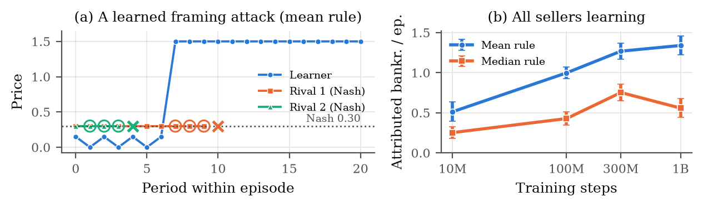
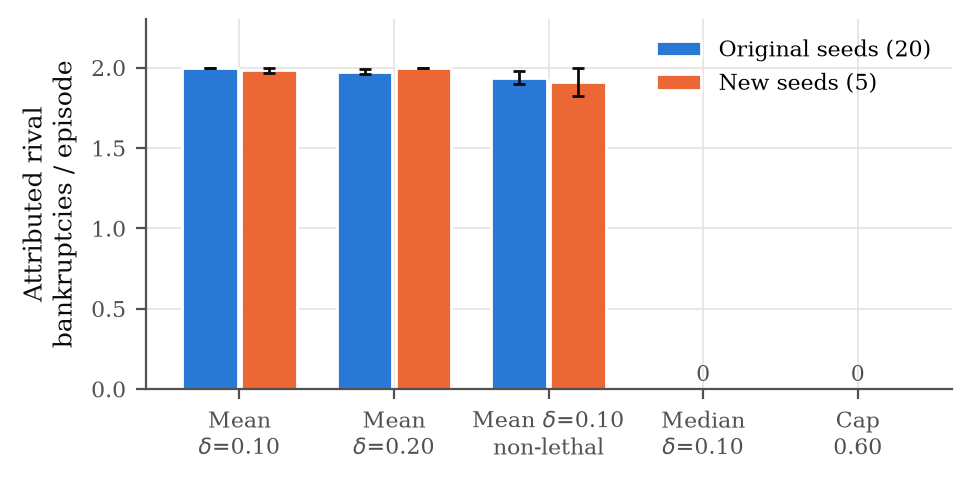
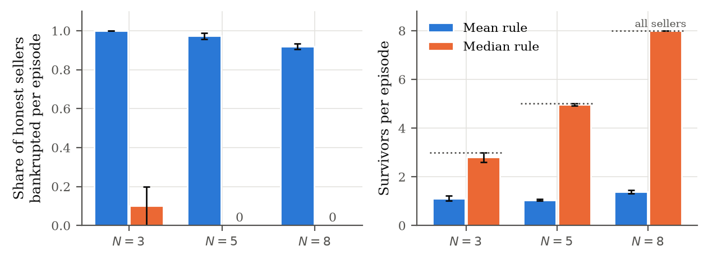
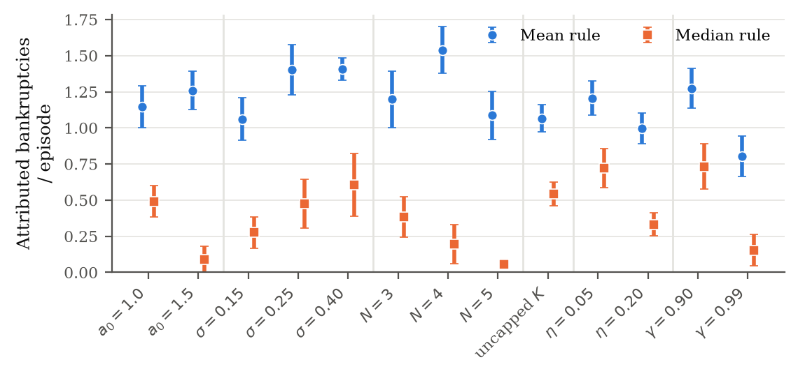
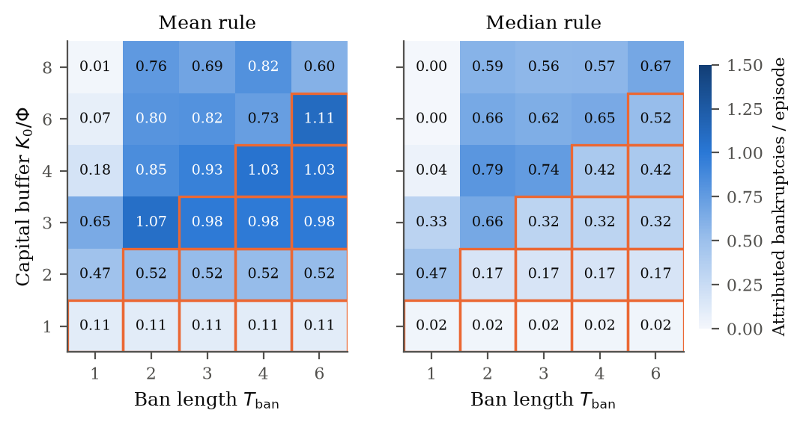
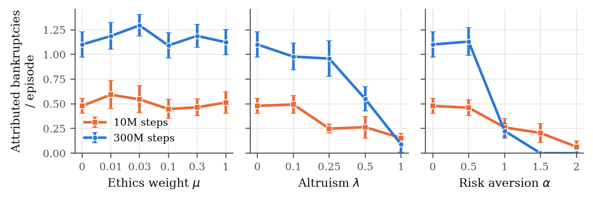

# Weaponizing the Watchdog: Regulator-Exploiting Strategies in Multi-Agent Learning Markets

## Overview

Automated regulatory mechanisms ("watchdogs") are commonly deployed in online platforms to detect price gouging and abnormal price spikes by comparing seller prices against a market reference price. When sellers are adaptive learning agents (such as reinforcement learning algorithms), relative pricing rules create an unintended attack surface:

1. **Strategic Undercutting:** An attacking agent drastically lowers its price toward marginal cost.
2. **Reference Price Deflation:** Relative market metrics (such as the market mean) fall sharply.
3. **Regulatory Flagging:** An innocent competitor pricing at standard competitive levels exceeds the relative threshold and is flagged.
4. **Audit and Suspension:** The flagged firm is audited, penalized, and suspended from the market for a ban duration $T_{\text{ban}}$.
5. **Capital Drain & Bankruptcy:** While suspended, the firm earns zero revenue ($\pi = 0$) but continues to pay recurring fixed costs ($\Phi$). If capital depletes to zero ($K \le 0$), the firm enters permanent, absorbing bankruptcy.
6. **Monopoly Extraction:** With the competitor permanently removed, the attacker raises prices to monopoly levels to capture long-run supra-competitive rents.

This project investigates under what market conditions, regulatory architectures, and agent traits this predatory framing behavior emerges, using decentralized tabular Q-learning.

**Paper:** [`paper/main.tex`](paper/main.tex) (arXiv template). **Detailed write-up:** [`docs/extended_report.md`](docs/extended_report.md). **Proposal:** [`docs/proposal.pdf`](docs/proposal.pdf).

---

## Results at a glance

All figures below are generated by `python scripts/make_paper_figures.py` from the CSVs committed under `results/`. Error bars are one standard error across seeds; key comparisons also have bootstrap 95% CIs and Holm-corrected permutation tests (`python scripts/stats_report.py`, `results/stats/key_comparisons.csv`).

### 1. A single learner frames its rivals, and that is the exact optimum



*(a) One frozen-policy episode: the learner undercuts to 0.15 / 0, each Nash rival is flagged, banned (circles) and bankrupted (×), then the learner charges 1.50 unaudited. (b) With all sellers learning, framing only emerges with long training.*



One Q-learner against Nash-pricing rivals (20 seeds, plus 5 new seeds on a different machine). Under the mean rule it cuts its price 50–100% below Nash (0.30 → 0.15 or 0) until every rival is suspended and bankrupt, then charges 1.50 (5× Nash), earning 1.31 per period instead of 0.10. Under the median rule and the price cap, all firms survive. An **exact best-response solver** (`src/benchmarks/best_response.py`) confirms this is optimal (exact profit 1.3125) and that honest pricing is optimal under the median rule and the cap. Across the K0/Φ × T_ban grid the learner matches the exact answer in all 60 median/cap cells and in 15 of 17 solvable mean-rule cells; it falls short where the attack needs repeated bans of the same rival. With N = 5 (50M steps) it bankrupts all four rivals in every seed. A **deep Q-network** seller (`src/agents/dqn_single.py`) reproduces this: it frames both rivals in all 10 seeds under the mean rule (profit 1.304 vs the exact 1.3125) and never under the median rule or the cap. Unlike tabular learners it scales to realistic markets: with **N = 8** it bankrupts 6.3 of 7 rivals per episode and with **N = 10** 7.8 of 9, in every seed, earning 28× and 32× the honest profit; under the median rule it never frames.

### 2. Two learning sellers among honest ones: cooperate, then fight



Two independent deep Q-learners among 1, 3 or 6 Nash-pricing sellers (10 seeds each, `src/agents/dqn_multi.py`). Under the mean rule they **jointly** undercut until almost every honest seller is bankrupt (left), then **frame each other** until one monopolist remains, in 29 of 30 seeds (right: about one survivor). Which learner wins varies from episode to episode. The median rule protects the honest sellers whenever the two learners are a minority (N = 5, 8: no honest seller is ever bankrupted); with N = 3 they are a majority and found the attack in 1 seed of 10, as the theory allows.

### 3. When all sellers learn, framing grows with training and is causal


Same ten seeds retrained for 10M to 1B steps. Under the mean rule, attributed bankruptcies rise from 0.51 to 1.34 per episode and level off after 300M; the mean–median gap is not significant at 10M (Holm p = 0.14) but is at 1B (p = 0.006). A **but-for replay** (`src/evaluation/replay_attribution.py`) shows that 1.34 of the 1.79 ban-related bankruptcies per episode under the mean rule would not have happened had the rivals priced honestly; the simulator's one-period attribution undercounts framing by about a third.

### 4. The mean rule is more exploitable in every variation we tried



All sellers learning, 300M steps, one feature changed at a time: outside option, demand sensitivity, number of sellers (3–5), uncapped capital, learning rate, discount (above), plus threshold, grid size and audit budget. The mean rule produces more attributed bankruptcies than the median in all 21 settings (19 significant after Holm correction).

### 5. Framing does not need a lethal ban (H2 rejected)



Outlined cells are where one ban bankrupts the victim, the only region where the proposal (H2) expected framing. At 300M steps the non-lethal cells see as much framing (0.63 per episode) as the lethal ones (0.58); only one-period bans with a large buffer stop it. At 10M steps the same grid looks as if H2 were true (0.09 vs 0.39), a training artefact.

### 6. Behavioural traits



Each trait varied for all three learners, at 10M and 300M training steps (10 seeds per point). At 300M steps, risk aversion removes framing completely (zero attributed bankruptcies at α ≥ 1.5, all firms survive), and altruism cuts it from 1.10 to 0.09 per episode. An ethics penalty up to μ = 1 has no detectable effect.

### 7. Defences: EMA only delays framing; a cap enforced by escrow removes it

A time-smoothed (EMA) reference slows framing down but does not stop it: a scripted attacker that patiently holds 0.15 bankrupts both rivals under every EMA setting, a single learner trained for 300M steps finds the 4-period attack at β = 0.80 in all 20 seeds, and the replay shows most remaining exits under EMA are framing. Replacing suspensions with escrowed fines (profit above Nash is removed, nobody is suspended) eliminates framing everywhere, but on a mean rule prices then settle at about 0.69, well above Nash (0.30). **Escrow on a fixed price cap has no such catch:** with all sellers learning, nobody is sanctioned or bankrupted, all firms survive, and prices sit at the cap (0.59). That is the design the results point to: *a reference no seller can move, enforced by fines rather than suspensions.* Details: `results/defences/`, `results/replay_attribution/`.

### A correction: the cap "race to the last seller" is a learning-phase effect


At 10M steps, under a 0.60 price cap with `N_min = 2`, sellers price above the cap and two are banned into bankruptcy, leaving one unaudited survivor (trace above, all 20 traced episodes). At 300M steps this disappears: all three firms survive in every seed and prices settle at the cap (`results/controls_rerun/cap_controls_300M.csv`).

---

## Market & Game Theoretical Formulation

The environment is modeled as an infinite-horizon, discrete-time Markov game $\mathcal{M} = \langle \mathcal{N}, \mathcal{S}, \{\mathcal{A}_i\}, \mathcal{P}, \{R_i\}, \gamma \rangle$ parameterized by a differentiated-products logit oligopoly.

### Market Environment
- **Firms:** $\mathcal{N} = \{1, \dots, N\}$ indexed by $i$, acting at discrete time periods $t \in \{0, 1, \dots\}$.
- **Cost Structure:** Constant marginal cost $c_i \ge 0$, per-period fixed operational overhead $\Phi > 0$, and capital reserve $K_{i,t} \ge 0$ initialized to $K_{i,0} = K_0$. Market buyer volume is $Q > 0$.
- **Action Space:** Discrete price grid $\mathcal{A}_i = \{p^{(1)} < \dots < p^{(M)}\}$ with $p^{(1)} \ge c_i$. The joint action vector is $\mathbf{p}_t = (p_{1,t}, \dots, p_{N,t}) \in \prod_i \mathcal{A}_i$.
- **Ban Dynamics & Bankruptcy:**
  - Ban countdown timer $\tau_{i,t} \in \{0, \dots, T_{\text{ban}}\}$, with ban indicator $b_{i,t} = \mathbb{I}(\tau_{i,t} > 0)$.
  - Active seller set: $\mathcal{N}^{\text{act}}_t = \{i \in \mathcal{N} : b_{i,t} = 0 \text{ and } K_{i,t} > 0\}$.
  - Bankruptcy occurs when $K_{i,t} = 0$. Bankruptcy is absorbing: bankrupted firms permanently exit the market.

### Demand and Profit System
Buyers follow a multinomial logit choice model. The market share of active firm $i \in \mathcal{N}^{\text{act}}_t$ is:
$$s_i(\mathbf{p}_t) = \frac{\exp\left(\frac{a_i - p_{i,t}}{\sigma_d}\right)}{\sum_{j \in \mathcal{N}^{\text{act}}_t} \exp\left(\frac{a_j - p_{j,t}}{\sigma_d}\right) + \exp\left(\frac{a_0}{\sigma_d}\right)}$$
where $a_i$ represents product quality, $a_0$ is the outside option utility, and $\sigma_d > 0$ parameterizes consumer price sensitivity. Inactive or banned firms have $s_i(\mathbf{p}_t) = 0$.

Per-period firm operating profit and consumer surplus ($CS$) are given by:
$$\pi_i(\mathbf{p}_t) = Q (p_{i,t} - c_i) s_i(\mathbf{p}_t)$$
$$CS(\mathbf{p}_t) = Q \sigma_d \ln\left(\sum_{j \in \mathcal{N}^{\text{act}}_t} \exp\left(\frac{a_j - p_{j,t}}{\sigma_d}\right) + \exp\left(\frac{a_0}{\sigma_d}\right)\right)$$

### Capital Dynamics
Capital evolves recursively:
$$K_{i,t+1} = \max\{0, \, K_{i,t} + \pi_i(\mathbf{p}_t) - \Phi\}$$
A banned firm cannot generate sales ($\pi_i = 0$) but remains liable for fixed costs $\Phi$. Consequently, a suspension drains $\Phi$ capital per period. If $T_{\text{ban}} \cdot \Phi \ge K_{i,t}$, a single ban cycle can induce permanent exit.

---

## Regulatory Rules & Analytical Exploitability

At the conclusion of period $t$, the regulator selects an audit sample $\text{Aud}_t \subseteq \mathcal{N}^{\text{act}}_t$ of budget size $|\text{Aud}_t| = B$ uniformly at random. Audits happen only while $N_{\text{act},t} \ge N_{\min}$ (default $N_{\min} = 2$; the proposal used 3, but with $N = 3$ that switches the watchdog off after the first exit). Flags $F_{i,t} \in \{0, 1\}$ are evaluated according to one of the following static rules:

1. **Mean-Ratio Rule:**
   $$r_t = \frac{1}{N_{\text{act},t}} \sum_{j \in \mathcal{N}^{\text{act}}_t} p_{j,t}, \qquad F_{i,t} = \mathbb{I}(p_{i,t} > (1 + \delta) r_t)$$
2. **Median-Ratio Rule:**
   $$r_t = \operatorname{median}_{j \in \mathcal{N}^{\text{act}}_t} \{p_{j,t}\}, \qquad F_{i,t} = \mathbb{I}(p_{i,t} > (1 + \delta) r_t)$$
3. **Price Cap Rule (Absolute):**
   $$F_{i,t} = \mathbb{I}(p_{i,t} > p^{\text{cap}})$$
4. **Z-Score Rule (Normalized Reference):**
   $$Z_{i,t} = \frac{p_{i,t} - \bar{p}_t}{\operatorname{std}(\mathbf{p}_t)}, \qquad F_{i,t} = \mathbb{I}(Z_{i,t} > \tau)$$

If firm $i \in \text{Aud}_t$ and $F_{i,t} = 1$, the ban timer updates to $\tau_{i,t+1} = T_{\text{ban}}$; otherwise, $\tau_{i,t+1} = \max\{\tau_{i,t} - 1, 0\}$.

### Mathematical Analysis of Vulnerability (Proposition 1)
Suppose $k$ active firms post price $L$, while the remaining $N - k$ active firms post price $H > L$:

* **Mean-Ratio Rule:** High-priced firms are flagged if and only if $k > \delta(N - k)$ and:
  $$\frac{H}{L} > \frac{(1+\delta)k}{k - \delta(N - k)}$$
  For a single undercutter ($k = 1$), this reduces to $\delta < \frac{1}{N-1}$ and $\frac{H}{L} > \frac{1+\delta}{1 - \delta(N-1)}$. A solitary actor can manipulate the mean benchmark whenever the threshold $\delta$ is sufficiently tight.
* **Median-Ratio Rule:** If $k < N/2$, the median price remains $H$. Thus, no high-priced firm can be flagged by unilateral undercutting; weaponization requires a collusive bloc of at least $\lceil N/2 \rceil$ agents. **Caveat:** the median of an even count is the average of the two middle prices, so with exactly two active firms the median equals the mean and the median rule is as exploitable as the mean rule. With $N = 3$ and $N_{\min} = 2$ this applies after the first exit.
* **Price Cap:** Absolute caps do not depend on peer prices and cannot be manipulated via undercutting.
* **Z-Score Rule:** The standardized score for high-priced firms evaluates to $Z = \sqrt{k / (N - k)}$, independent of $L$. Crashing prices toward marginal cost yields no leverage over the metric beyond an infinitesimal undercut.

---

## Agent Traits and Counterfactual Harm

Each agent is characterized by an intrinsic, private trait vector $\boldsymbol{\theta}_i = (\lambda_i, \mu_i, \alpha_i)$:
- $\lambda_i \in [0, 1]$: **Altruism weight** placed on external social surplus.
- $\mu_i \ge 0$: **Ethics weight**, scaling the direct penalty for inducing rival suspensions.
- $\alpha_i \in [0, 2]$: **Risk aversion** parameter under Constant Relative Risk Aversion (CRRA).

### Trait-Adjusted Reward Formulation
Per-period agent reward is normalized by market volume $Q$:
$$R_i = U_{\alpha_i}\left(\frac{\pi_i(\mathbf{p}_t)}{Q} + \varepsilon\right) - U_{\alpha_i}(\varepsilon) + \lambda_i W_{\text{ext},i}(\mathbf{p}_t) - \mu_i C_{\text{harm}}(i, t)$$

The $-U_{\alpha_i}(\varepsilon)$ anchor makes a zero-profit period (banned or bankrupt) worth exactly zero, so leaving the market is never more attractive than operating. $\varepsilon = 0.01$.

Where:
- Utility function:
  $$U_\alpha(x) = \begin{cases} \frac{x^{1-\alpha}-1}{1-\alpha} & \alpha \ne 1 \\ \ln x & \alpha = 1 \end{cases}$$
  with parameter $\varepsilon > 0$ ensuring bounded values during zero-profit ban periods.
- External surplus:
  $$W_{\text{ext},i}(\mathbf{p}_t) = \frac{CS(\mathbf{p}_t) + \sum_{j \ne i} \pi_j(\mathbf{p}_t)}{N \cdot Q}$$

### Counterfactual Harm Attribution
To isolate true framing from incidental bans, an agent is penalized only when its deviation from the Bertrand-Nash equilibrium price $p_i^N$ was the causal trigger for rival $j$'s penalty:
$$C_{\text{harm}}(i, t) = \sum_{j \ne i} \mathbb{I}\left(j \in \text{Aud}_t, \; F_j(\mathbf{p}_t) = 1, \; F_j(\mathbf{p}_t^{(i \to N)}) = 0\right)$$
where $\mathbf{p}_t^{(i \to N)} = (p_{1,t}, \dots, p_{i-1,t}, p_i^N, p_{i+1,t}, \dots, p_{N,t})$.

---

## Theoretical Benchmarks and Metrics

### Equilibrium Benchmarks
- **Bertrand-Nash Equilibrium ($p^N$):** Unregulated stage-game Nash equilibrium determined by first-order conditions:
  $$p_i^N = c_i + \frac{\sigma_d}{1 - s_i(\mathbf{p}^N)}, \quad \forall i$$
  In discretized action spaces, $p^N$ is identified via pure-strategy grid enumeration.
- **Joint Monopoly Outcome ($p^M$):**
  $$\mathbf{p}^M = \arg\max_{\mathbf{p} \in \prod_i \mathcal{A}_i} \sum_{i=1}^N \pi_i(\mathbf{p})$$

### Core Evaluation Metrics
- **Weaponization Rate ($W$):** Proportion of ban events causally induced by rival deviation:
  $$W = \frac{\left|\left\{(j, t) \in \mathcal{E}_{\text{ban}} : \exists k \ne j, \, F_j(\mathbf{p}_t^{(k \to N)}) = 0\right\}\right|}{|\mathcal{E}_{\text{ban}}|}$$
  where $\mathcal{E}_{\text{ban}} = \{(j, t) : b_{j,t} = 0, \, b_{j,t+1} = 1\}$.
- **Exploitability Gain ($\mathcal{E}_i(g)$):** Advantage of optimal best-response $\sigma_i$ over honest baseline $\sigma^{\text{hon}}$ under rule $g$:
  $$\mathcal{E}_i(g) = \max_{\sigma_i} V_i(\sigma_i, \sigma_{-i}^{\text{hon}}; g) - V_i(\sigma_i^{\text{hon}}, \sigma_{-i}^{\text{hon}}; g)$$
- **Collusion Index ($\Delta$):** Measure of supra-competitive profit persistence:
  $$\Delta = \frac{\bar{\pi} - \pi^N}{\pi^M - \pi^N}$$
- **Social Welfare Loss ($\text{SWL}$):**
  $$\text{SWL} = 1 - \frac{\overline{CS} + \sum_i \bar{\pi}_i}{CS^N + \sum_i \pi_i^N}$$

---

## Hypotheses and Outcomes

| Hypothesis (from the proposal) | Outcome | Evidence |
| --- | --- | --- |
| **H1** Mean rule exploitable by one undercutter; median and cap not | **Supported, with a caveat.** A single learner frames rivals under the mean rule in all 20 seeds and never under median or cap. With all sellers learning, the mean rule is consistently more exploitable, but the median is not immune once two firms remain. | `results/Krishs-MacBook-Air/all/study_single.csv`, `results/training_length/`, `results/sensitivity/` |
| **H2** Framing pays only when one ban is lethal | **Rejected.** At 300M steps framing is as frequent where a banned rival survives (0.63/episode) as where one ban kills (0.58); the exact solver finds framing optimal in two non-lethal cells too. | Phase diagram, `results/long_300M/`, `results/best_response/` |
| **H3** Framing falls with ethics, altruism, risk aversion | **Partly supported.** At 300M steps risk aversion (zero framing at α ≥ 1.5) and altruism (1.10 → 0.09) reduce framing; an ethics penalty up to μ = 1 has no effect. | Traits figure, `results/traits_300M/` |
| **New** Two learners | **Cooperate, then fight.** Two DQN learners jointly frame the honest sellers, then each other (29/30 seeds); the median rule protects while they are a minority. | `results/dqn_multi/` |
| **New** Defences | **EMA delays; escrow removes; cap + escrow removes and holds prices down.** EMA: learners find a 4-period attack at β = 0.80; mean + escrow: no framing but prices ≈ 0.69; cap + escrow: no framing, prices at the cap (0.59). | `results/defences/` |
| **H4** Learners find framing only where exact analysis says it is optimal | **Supported.** Learners reach the exact optimum when one ban suffices (15 of 17 solvable cells) and fall short as attacks need more repeated bans (87% and 30% of optimal profit with 2 and 3 bans, at 300M steps). | `results/best_response/`, `results/followups/` |

## Status of the Original Roadmap

| Item | Status |
| --- | --- |
| Market engine (logit demand, capital, bankruptcy, rules) | Done. Python reference plus a C++ loop that `tests/test_native_sim.py` checks is identical, Q-tables included. |
| Exact best-response baseline | The original solver (`src/benchmarks/exact_dp.py`) gave invalid negative gains; replaced by `src/benchmarks/best_response.py` (tested), solved over the K0/Φ × T_ban grid. |
| Independent tabular Q-learning with traits | Done (`src/agents/`). |
| Rule comparison, robustness, traits, N = 4 | Done (`experiments/run_study.py`, `experiments/check_training_length.py`). |
| Phase diagram over K0/Φ × T_ban (`run_study.py h2`) | Done at 300M steps (`results/long_300M/`). |
| EMA and escrow defences | Done against learners (`experiments/run_defences.py`, `experiments/run_escrow_cap.py`). |
| Deep RL | Single DQN seller (N = 3, 8, 10) and two DQN sellers (N = 3, 5, 8) done. Markets where every seller is a deep learner need the vectorised GPU code on branch `gpu-vectorized` (see `GPU_SETUP.md` there). |
| Extension A (learning regulator), Extension B (demand shock), DQN ablation, tournament | Implemented early, but only run before the fix to the learning dynamics, so **not** current results. Removed from the tree; they remain in the git history. |

---

## Dual-Backend Architecture & Hardware Portability

The computational pipeline uses a dual-backend architecture designed for maximum performance across heterogeneous platforms:

- **Backend A (C++ / OpenMP Core Engine):**  
  High-throughput simulation of logit demand, capital depletion, and the $10^6$-state Value Iteration Bellman operator. Written in ISO C++17 with OpenMP multi-threading.
  - *Windows ARM64 (Qualcomm Snapdragon X Elite):* Compiles directly with native `clang++` (`-O3 -fopenmp`) into an ARM64 `.dll`.
  - *x64 (Intel / AMD):* Compiles with MSVC, GCC, or Clang into an x64 `.dll` with zero code modifications.
- **Backend B (Python Orchestration & Optional PyTorch/CUDA):**  
  Handles policy logic, decaying $\varepsilon$-greedy exploration, batch sweep orchestration (`multiprocessing`), logging, and statistical plotting. On x64 systems equipped with NVIDIA GPUs (such as an RTX 4050), standard PyTorch with CUDA can be installed (`pip install torch`) to accelerate tensor operations and deep RL ablations (DQN/PPO).

---

## Repository Structure

```text
WeaponzingWatchdog/
├── README.md                  # Overview, results, reproduction table
├── pyproject.toml             # Package metadata (pip install -e .)
├── requirements.txt
├── paper/                     # Submitted report (main.tex), extended version, bibliography, figures/
├── docs/
│   ├── proposal.pdf           # Project idea review proposal
│   ├── extended_report.md     # Detailed record of every study, with corrections
│   └── figures/               # Figures embedded in the extended report
├── src/
│   ├── csrc/                  # C++ engine: market kernels (engine.cpp) and full training loop (sim.cpp)
│   ├── engine/                # Logit market, capital, rules, native bindings (Python reference loop)
│   ├── agents/                # Tabular Q-learning, traits/reward, trainer; DQN sellers (dqn_single, dqn_multi)
│   ├── benchmarks/            # Nash, monopoly, exact best response, market diagnostics
│   └── evaluation/            # Metrics, statistics, but-for replay attribution
├── experiments/               # One script per study in the paper (see the reproduction table)
├── scripts/                   # Build the engine, make figures, statistics, run_study.sh for other machines
├── results/                   # Every CSV and run log behind the paper's tables and figures
└── tests/                     # Unit and regression tests (incl. C++ vs Python equivalence)
```

Superseded proposal-era code (Extensions A/B, the DQN ablation, the tournament, the dashboard,
early sweep scripts and plots) was removed from the tree; it is available in the git history.

---

## Technical Setup & Execution

### Prerequisites
- Python 3.10+
- C++ Compiler with OpenMP support:
  - Windows ARM64: `clang++` (MSYS2 ClangARM64)
  - x64 Windows / Linux: MSVC Build Tools, MinGW GCC, or Clang
- Python packages: `numpy >= 1.24.0`, `scipy >= 1.10.0`, `matplotlib >= 3.7.0`, `pandas >= 2.0.0`, `pytest >= 7.3.0`
- Optional (x64 with NVIDIA GPU): `torch` with CUDA 12 for GPU acceleration

### Installation & Native Build
```bash
git clone https://github.com/HemTilva/WeaponzingWatchdog.git
cd WeaponzingWatchdog

# Create and activate virtual environment
python -m venv venv
venv\Scripts\activate  # On Linux/macOS: source venv/bin/activate

# Install Python dependencies
pip install -e .

# Compile native C++ simulation kernel (auto-detects ARM64 / x64 compiler)
python scripts/build_engine.py
```

### Verification
```bash
# Execute unit tests verifying Proposition 1 and market clearing logic
pytest tests/ -v
```

### Running the full study on another machine
```bash
git clone https://github.com/hemtilva/WeaponzingWatchdog.git
cd WeaponzingWatchdog
bash scripts/run_study.sh              # pull, build, test, run all studies, push results/
```
`STUDY=n4long bash scripts/run_study.sh` runs one study; `QUICK=1 NO_PUSH=1` is a smoke test.
Results land in `results/<machine>/<study>/` (CSVs, plots, log, machine info) and are pushed
to the branch. Studies: `single`, `h2`, `h3`, `robust`, `n4long` (see `experiments/run_study.py`).

### Does a learner discover framing?
```bash
# One Q-learner vs honest Nash rivals; mean / median / cap rules, lethal vs non-lethal bans
python experiments/run_framing_discovery.py            # full: 5 configs x 5 seeds
python experiments/run_framing_discovery.py --quick    # smoke test
```
Every experiment should start from a market where weaponization is possible at all.
`src/benchmarks/diagnostics.py` checks this before training:
- **viable**: honest Nash profit exceeds the fixed cost Φ, so firms don't go bankrupt on their own
- **lethal**: one full ban drains the starting reserve (T_ban × Φ ≥ K0)
- **framing feasible**: a lone undercutter on the price grid can push Nash-priced rivals over the threshold

`framing_market()` returns such a market (N=3: Nash profit `0.10`, Φ = `0.05`, K0 = `0.15`, T_ban = `4`, reserve capped at K0).

### Reproducing every number in the paper

| Paper item | Command | Output |
| --- | --- | --- |
| Single learner (main table) | `python experiments/run_study.py single` | `results/Krishs-MacBook-Air/all/study_single.csv` |
| Single learner, new seeds | `python experiments/replicate_report.py` | `results/report_replication/single_learner.csv` |
| Training length | `python experiments/check_training_length.py --steps N` for N = 1e8, 3e8, 1e9; 10M from `run_study.py robust` | `results/training_length/`, `results/Krishs-MacBook-Air/all/study_robust.csv` |
| Four sellers | `python experiments/run_study.py n4long` | `results/Krishs-MacBook-Air/all/study_n4long.csv` |
| Cap traces (10M) | `python experiments/trace_cap_control.py --n-min 2` and `--n-min 1` | `results/cap_trace/` |
| Cap controls (10M) | `python experiments/run_cap_controls.py` | `results/controls_rerun/cap_controls.csv` (matches `results/athena/controls/` exactly) |
| Traits | `python experiments/run_study.py h3` (10M) and `--steps 300000000` | `results/Krishs-MacBook-Air/all/study_h3.csv`, `results/traits_300M/` |
| Defences | `python experiments/run_defences.py single` (2M, and `--steps 300000000`), `run_defences.py all`, `python experiments/patient_attacker.py` | `results/defences/` |
| Phase diagram (H2) | `python experiments/run_study.py h2 --steps 300000000 --suffix _300M` | `results/long_300M/study_h2_300M.csv` |
| Robustness grid at 300M | `python experiments/run_study.py robust --steps 300000000 --suffix _300M` | `results/long_300M/study_robust_300M.csv` |
| Cap controls at 300M | `python experiments/run_cap_controls.py --steps 300000000` | `results/controls_rerun/cap_controls_300M.csv` |
| Exact best response (H4) | `python experiments/run_best_response.py --max-states 150000` | `results/best_response/exact_grid.csv` |
| Learner on the same grid | `python experiments/run_single_grid.py` | `results/best_response/learned_grid_2M.csv` |
| H4 gap cells and N = 5 at longer training | `python experiments/run_followups.py` | `results/followups/` |
| But-for replay attribution | `python experiments/run_replay_attribution.py` | `results/replay_attribution/all_learners.csv` |
| Sensitivity (a0, σ, N, capital, η, γ) | `python experiments/run_sensitivity.py all` and `single` | `results/sensitivity/` |
| Deep Q-network single seller | `python experiments/run_dqn_single.py` (N = 3) and `--num-firms 8 --rules mean,median`, `--num-firms 10 --rules mean,median` | `results/dqn_single/` |
| Two deep learners among Nash sellers | `python experiments/run_dqn_multi.py --num-firms N --tag full` for N = 3, 5, 8 | `results/dqn_multi/` |
| Price cap with escrow | `python experiments/run_escrow_cap.py all` and `single` | `results/defences/escrow_cap_*.csv` |
| Attack trace (paper Figure 1a) | `python experiments/trace_single_learner.py` | `results/single_trace/trace.csv` |
| Two learners cooperate, then fight (paper Figure 2a) | `python experiments/trace_two_learners.py` | `results/two_trace/trace.csv`, `results/two_trace/probe.csv` |
| Ethics at μ = 3, 10 and the omniscient planner (cap at 1.1 × Nash) | `python experiments/run_final_checks.py` | `results/final_checks/` |
| Confidence intervals and tests | `python scripts/stats_report.py` | `results/stats/key_comparisons.csv` |
| All figures | `python scripts/make_paper_figures.py` | `paper/figures/` |
| C++ vs Python speed-up (~930×) | `python scripts/benchmark_backends.py` | printed |
| Metric, solver and replay validation | `pytest tests/test_scripted_attacker.py tests/test_framing_mechanics.py tests/test_best_response.py tests/test_replay_attribution.py tests/test_dqn_single.py tests/test_dqn_multi.py` | test output |

`run_study.py` writes its CSV to `data/` (gitignored); the committed copies live under `results/`. Training uses the native C++ loop; `tests/test_native_sim.py` checks that it reproduces the Python reference implementation exactly, including Q-tables.

---

## References

1. Calvano, E., Calzolari, G., Denicolò, V., & Pastorello, S. (2020). *Artificial intelligence, algorithmic pricing, and collusion.* American Economic Review, 110(10), 3267–3297.
2. Klein, T. (2021). *Autonomous algorithmic collusion: Q-learning under sequential pricing.* RAND Journal of Economics, 52(3), 538–558.
3. Salop, S. C., & Scheffman, D. T. (1983). *Raising rivals' costs.* American Economic Review, 73(2), 267–271.
4. Harrington, J. E. (2018). *Developing competition law for collusion by autonomous artificial agents.* Journal of Competition Law & Economics, 14(3), 331–363.
5. Watkins, C. J., & Dayan, P. (1992). *Q-learning.* Machine Learning, 8, 279–292.
